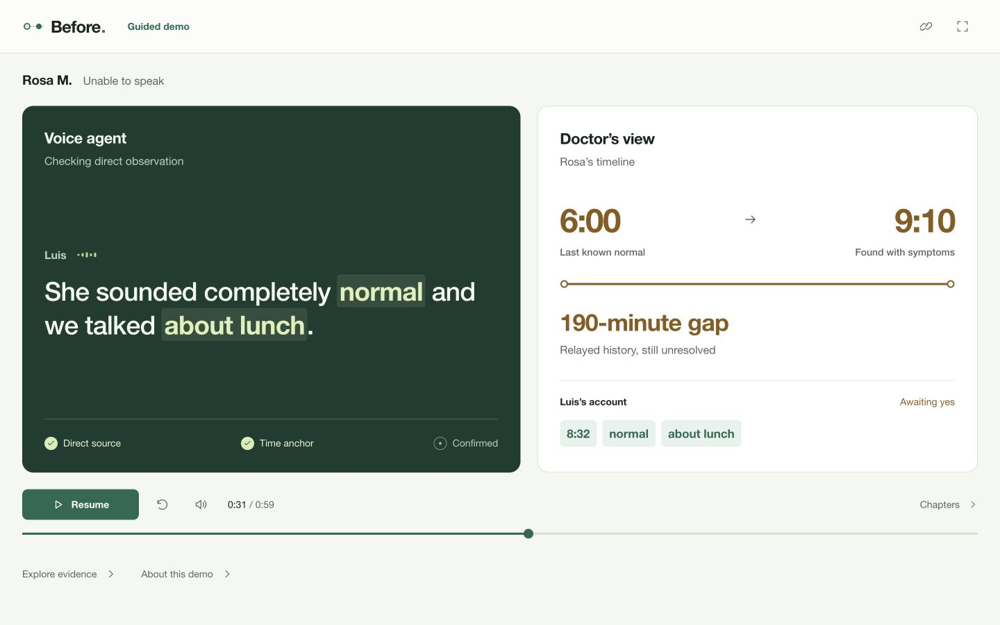

<p align="center">
  <picture>
    <source media="(prefers-color-scheme: dark)" srcset="assets/logo-dark.svg">
    
  </picture>
</p>

<p align="center"><b>The story before the hospital.</b><br>A voice agent asks the people who were there. Every claim keeps its source.</p>

Before reconstructs a stroke patient's timeline from witness conversations. The agent separates direct observations from hearsay, asks for a checkable time anchor, reads the full claim back, and waits for an explicit yes. A deterministic validator checks the transcript before the live workflow can write preliminary evidence to Medplum. The clinician reviews it.



## Play the demo

**[Open the hosted demo](https://before.veersingh.com/demo)** · [Portfolio](https://veersingh.com/projects)

Node 24+ and pnpm via Corepack. No API keys, Docker, microphone, or accounts required for the guided demo.

```sh
corepack enable
pnpm install --frozen-lockfile
pnpm demo
```

Open **[localhost:3200](http://localhost:3200)** for the overview or **[localhost:3200/demo](http://localhost:3200/demo)** for the interactive presentation.

- A one-minute prerecorded voice interview with synchronized captions, pause, seek, mute, restart, and seven selectable chapters.
- A witness-confirmed 8:32 baseline: the initial 190-minute gap becomes a 38-minute interval.
- Key phrases such as “normal” and “about lunch” appear as draft evidence while the doctor’s timeline waits for the spoken confirmation.
- The ending pulls back to reveal four additional agents. Five independent accounts build one chart: a later 8:46 baseline and a 9:08 discovery narrow the final interval to 22 minutes. A text contact adds context without establishing normality.
- The **Voice agent** panel gathers the history. **Doctor’s view** shows the resulting timeline; click a source to inspect its evidence.
- Open **Explore evidence** and use **Test the validator** to change the claimed time, remove the call-log anchor, or remove the witness's yes and see the actual validator reject the claim.
- Hear Deepgram TTS voices on both sides. The bundled audio clock drives the captions, evidence gates, and timeline update.
- Open **Explore evidence** for the transcript, simulated clinician review, original handoff, validator, and evidence JSON. **About this demo** holds provider credits, keyboard controls, disclosures, and the live workspace link.

The guided demo uses synthetic fixtures and local validation. It makes no chart writes. Its FHIR references and clinician actions are illustrative. The four additional calls are a scripted concept reveal after Luis’s recorded interview, not newly placed live calls. All five fixtures pass the production validator and have independently inspectable transcripts.

## Present it in one minute

1. Open `/demo`, enter full screen, and press **Play with sound**.
2. Let the voices lead. The captions and evidence gates follow each turn.
3. At **Read-back**, point out that the timeline is still unchanged.
4. Open **Chapters** to jump to **Confirmed** or **Parallel**, then watch the additional accounts land in the doctor’s view. **Full chart** jumps to all five sources; click any source to inspect its evidence.
5. Open **Explore evidence**, then **Test this claim** to block the unsupported 8:30 time. Close with: “The agent collects the history. The evidence keeps its source. The clinician decides.”

Space plays or pauses; left and right arrows select chapters when focus is outside a control. **Copy demo link** copies the current URL; it is shareable when the app is hosted.

## Live voice workflow

The existing live integration uses **Deepgram Voice Agent** for the browser interview, **Medplum** for FHIR evidence and provenance, and an optional **Vapi** phone leg. ElevenLabs and other voice providers are not integrated.

Configure `.env.local` from `.env.example`, bootstrap and seed Medplum, and run:

```sh
pnpm demo:live --no-phone
```

Then open `/test` for integration checks, `/clinician` for the coordinator and clinician, and `/witness` for the browser microphone endpoint. The three coordinator gates remain required. When Medplum is unavailable, the workspace explains the setup and links back to the guided demo.

See [LIVE-INTEGRATION.md](LIVE-INTEGRATION.md) for local setup, interview choreography, and optional telephony. The live provider path was not re-run as part of the showcase polish.

## What makes this interesting for voice teams

The conversation has to resolve uncertainty, not simply transcribe it. Spoken evidence must survive a strict boundary between the voice model and the clinical record:

| Boundary | Enforced behavior |
|---|---|
| Witness origin | Exact time must appear in the witness's own turns after an anchor request. |
| Time anchor | An exact time needs a checkable source such as a call log. |
| Confirmation | The final spoken read-back and the witness's affirmation must match the claim. |
| Authority | The live agent creates preliminary evidence; a separate clinician identity adjudicates. |
| Traceability | Field evidence links to quotes and transcript turn IDs; live resources carry provenance. |

The guided demo runs the same validator as the live workflow. It is a presentation of the mechanism, not a live service or a clinically validated product.

## Development

```sh
pnpm dev
pnpm check
pnpm build
pnpm start
```

Stop the development server before building; both use `.next`. The test suite covers claim validation, timeline layout, and the demo's confirmation and interval boundaries.

| Route | Purpose |
|---|---|
| `/` | Product overview |
| `/demo` | Credential-free interactive showcase |
| `/clinician` | Live Medplum clinical workspace |
| `/witness` | Live Deepgram browser interview |
| `/test` | Live integration checks |

The presentation fixture lives in `lib/demo/scenario.ts`; the evidence inspector is shared with the live workspace. `lib/claims/validate.ts` owns the evidence gates. `lib/timeline/interval.ts` computes the interval without model inference. `lib/demo/audio-cues.json` records exact turn timings and a script hash so changes cannot silently separate captions from the recording.

To author a new bundled recording after changing the script, run `node --import tsx scripts/render-demo-audio.ts` with a configured Deepgram key and ffmpeg. This sends only the synthetic script for TTS generation. Demo playback never calls Deepgram.

## Hosting

This is a standard Next.js app. A fresh install with no provider environment variables builds and serves the overview and guided demo. The Netlify configuration uses Node 24, pnpm, and the automatic Next.js runtime. Set `NEXT_PUBLIC_SITE_URL` to the hosted URL for social previews.

The hosted guided presentation has no live provider credentials. The local operator APIs are not an authenticated public application. Public live use requires caller authorization; Deepgram session grants fail closed and never return the server key. See [LIVE-INTEGRATION.md](LIVE-INTEGRATION.md).

The evidence fixture, bundled audio, and four extra call accounts are synthetic. Human witness recordings can replace the bundled witness clips after their captions and confirmation timing are updated; see [recordings/README.md](recordings/README.md).

## Credits

Originally built by Veer Singh and [Will](https://github.com/willzhang100) at the YC × Medplum hackathon. See [CREDITS.md](CREDITS.md) for the voice and evidence integrations.
